Like It's Lunch is a web application security practice lab I'm building for myself. The idea is to take real-world vulnerabilities, rebuild them from scratch, and then explain them in simple terms using analogies about lunch.

The lab is going to be completely local and isolated. Vulnerable apps will run on my Windows host, with an Ubuntu VM acting as my attacker box for Burp and whatever other tools I need. Nothing is exposed to the public internet, so I can build intentionally vulnerable applications and attack them safely.

This post covers setting up the attacker box from scratch.

---

**The setup at a glance**

- **Host:** AMD Ryzen 5 5600X (6c/12t), 48 GB RAM, Windows 10 Home.
- **Attacker VM:** Ubuntu running under VMware Workstation Pro.
- **Target apps:** run on the Windows host (built in later posts).
- **Isolation:** the attacker VM can reach the internet to pull tools, and reach the host to attack it, but the lab traffic stays self-contained.

---

## 1. Pick a hypervisor

Windows 10 Home doesn't give me the full Hyper-V Manager, so I was really choosing between VMware and VirtualBox. I went with **VMware Workstation Pro**. It's free for personal use now, and it gets me the better performance, cleaner snapshots, and the Host-Only networking I wanted for this setup.

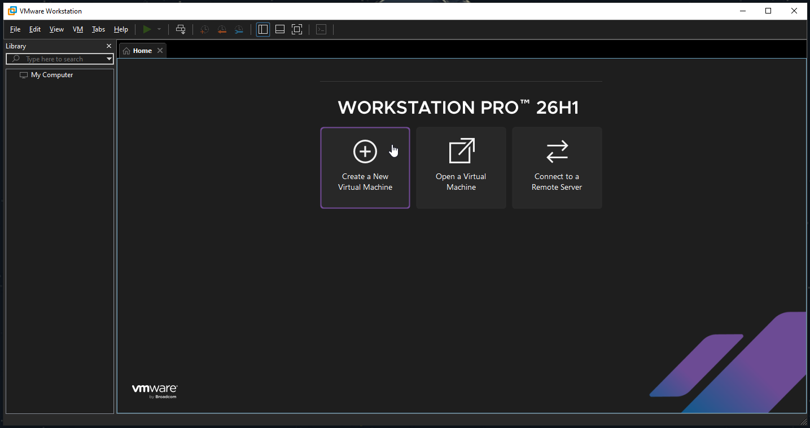

## 2. Build the Ubuntu attacker VM

I'm using **Ubuntu Desktop** rather than Kali. I already work in Ubuntu day to day, so I'd rather start from something familiar and install security tools as I actually need them.

The VM's specs:

- 4 vCPU
- 16 GB RAM
- 60 GB single-file virtual disk, stored on my D: drive (my C: drive is nearly full)

The networking is the part I actually cared about here. I gave the VM **two** adapters:

- **Adapter 1 (NAT):** gives Ubuntu internet access to install and update tools.
- **Adapter 2 (Host-Only):** gives Ubuntu a private path to the vulnerable apps running on the host.

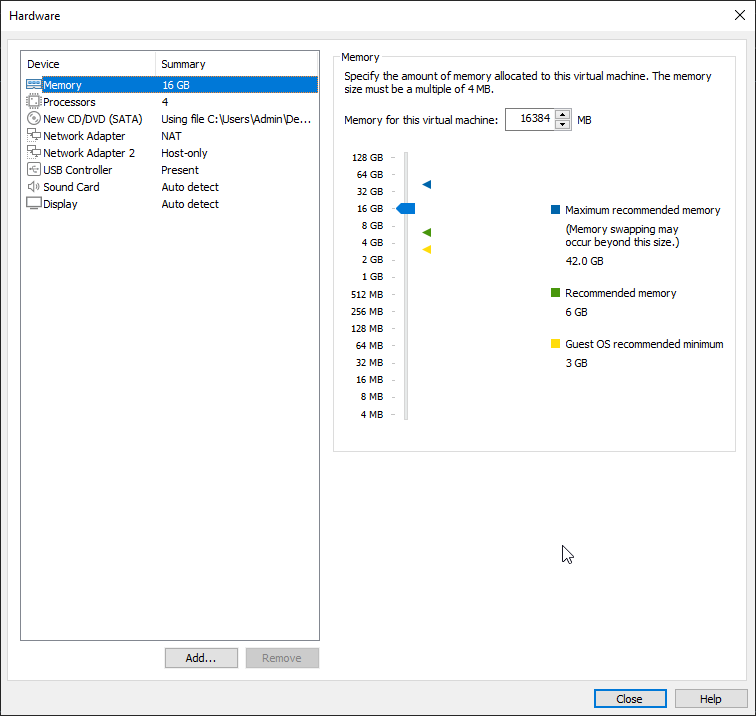

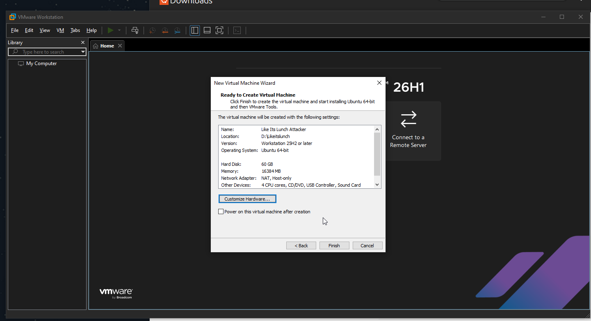

From there it's a standard Ubuntu install. A few minutes later I'm at the desktop:

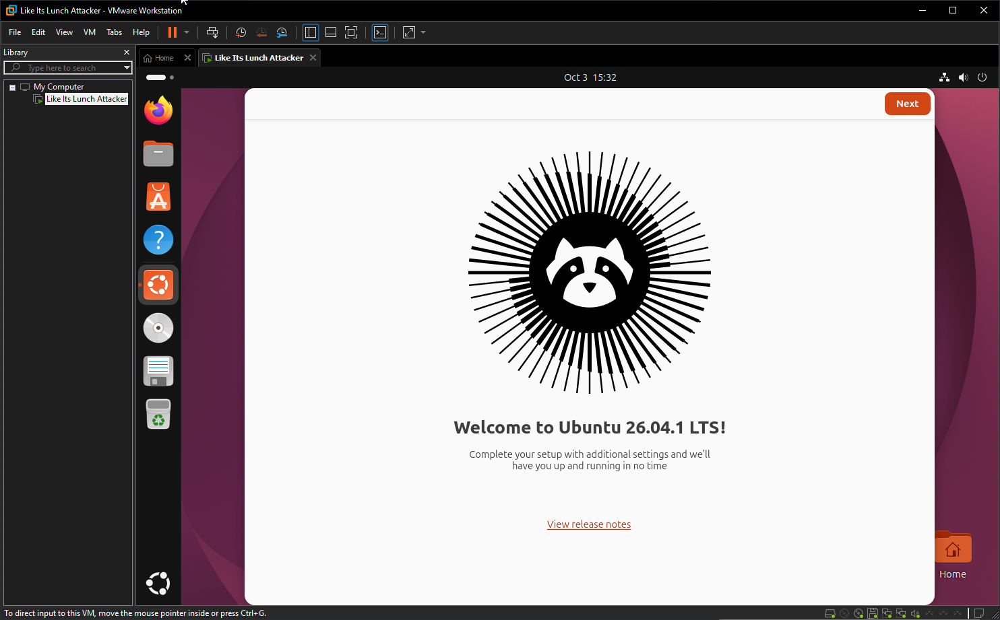

After first boot I installed VMware's guest tools for clipboard integration and display resizing:

```bash
sudo apt install -y open-vm-tools open-vm-tools-desktop
```

## 3. Verify the networking

This is probably the most important part of the network setup, so I wanted to make sure it was actually working the way I thought it was. VMware put the Host-Only network on `192.168.175.0/24`, with the Windows host at `192.168.175.1`.

From inside the VM I checked the three things I actually care about: both network adapters have addresses, I can still reach the internet through NAT, and I can reach the Windows host directly over the Host-Only network.

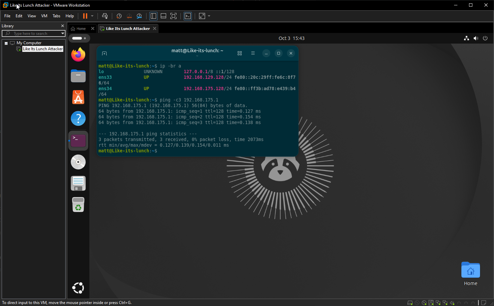

One detail I like: the ping replies came back with **TTL 128**, the Windows default (Linux starts at 64). That confirms it's genuinely the Windows host answering over the private link, exactly as intended.

## 4. Snapshot the clean box

With the VM built and the networking confirmed, but *before* I installed any tools, I took a VMware snapshot. This is my clean baseline. Whenever I want to start over I can just revert to it, so the box doesn't slowly drift on me as I install things, change configs, and inevitably break stuff.

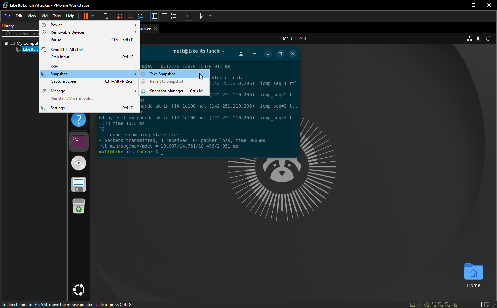

## 5. Install the attacker tooling

With that snapshot saved, I started actually building out the toolset. First a system update and the base dependencies I knew I'd want:

```bash
sudo apt update && sudo apt upgrade -y
sudo apt install -y curl wget git python3 python3-pip python3-venv pipx nmap jq unzip
```

Then I grabbed the current release of Go, so I could pull a bunch of tools straight from source:

```bash
cd /tmp
LATEST=$(curl -s https://go.dev/VERSION?m=text | head -n1)
wget "https://go.dev/dl/${LATEST}.linux-amd64.tar.gz"
sudo rm -rf /usr/local/go
sudo tar -C /usr/local -xzf "${LATEST}.linux-amd64.tar.gz"
echo 'export PATH=$PATH:/usr/local/go/bin:$HOME/go/bin' >> ~/.bashrc
source ~/.bashrc
go version
```

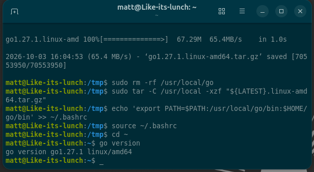

Once Go was working, I installed my initial web-security and recon kit: `ffuf`, `httpx`, `nuclei`, `subfinder`, `gospider`, `dalfox`, `assetfinder`, `gau`, `waybackurls`, and `gf`. Then I cloned `sqlmap` from its repo and updated the Nuclei templates.

```bash
go install github.com/ffuf/ffuf/v2@latest
go install github.com/projectdiscovery/httpx/cmd/httpx@latest
go install github.com/projectdiscovery/nuclei/v3/cmd/nuclei@latest
go install github.com/projectdiscovery/subfinder/v2/cmd/subfinder@latest
go install github.com/jaeles-project/gospider@latest
go install github.com/hahwul/dalfox/v2@latest
go install github.com/tomnomnom/assetfinder@latest
go install github.com/lc/gau/v2/cmd/gau@latest
go install github.com/tomnomnom/waybackurls@latest
go install github.com/tomnomnom/gf@latest
```

`sqlmap` isn't a Go tool, so I cloned it from its repo and set up an alias to run it from anywhere:

```bash
git clone --depth 1 https://github.com/sqlmapproject/sqlmap.git ~/tools/sqlmap
echo "alias sqlmap='python3 ~/tools/sqlmap/sqlmap.py'" >> ~/.bashrc
source ~/.bashrc
```

Finally, I seeded the Nuclei templates so it has something to scan with:

```bash
nuclei -update-templates
```

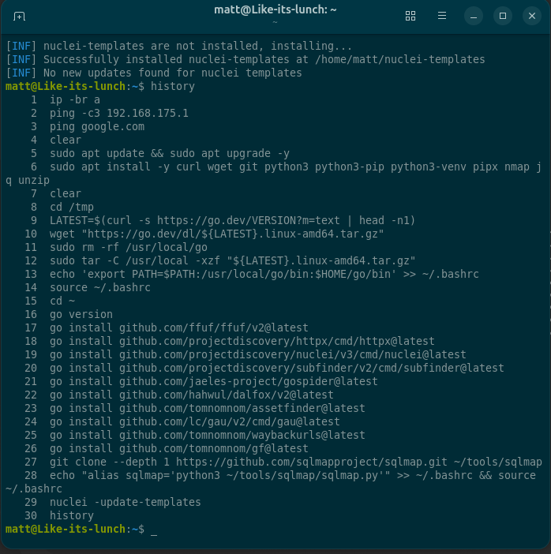

## 6. Burp Suite and the browser

For manual testing I installed **Burp Suite Professional**. This is where I'll do most of the actual testing, intercepting and modifying requests, sending them to Repeater, looking through responses, and testing whatever looks interesting.

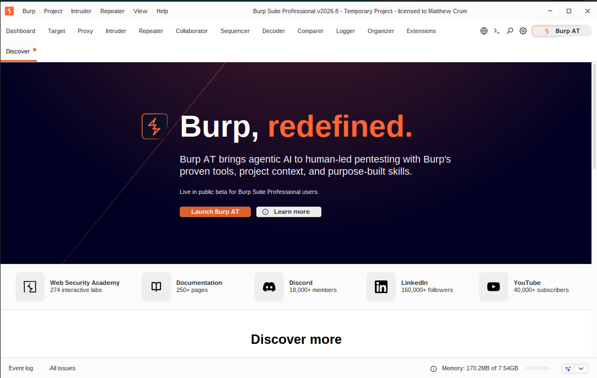

On the browser side I added **FoxyProxy** (to flip Firefox between normal traffic and Burp without digging through settings every time) and **Wappalyzer** (to fingerprint the target's tech stack). With FoxyProxy enabled, traffic flows:

```
Firefox → FoxyProxy → Burp Suite → Target
```

## 7. Setting up Burp: Jython and extensions

Burp Pro does plenty on its own, but the extensions are what I'll actually use day to day, so setting up my extension kit was the last step. One thing to know first: some extensions are written in Python, and Burp needs Jython (a Python interpreter that runs on Java) to load those. Burp tells you as soon as you try to install one.

I ran into this installing **Autorize** from the BApp Store (Extensions → BApp Store). Its description says that to use Python extensions you need to download the Jython standalone JAR and set its location in Burp.

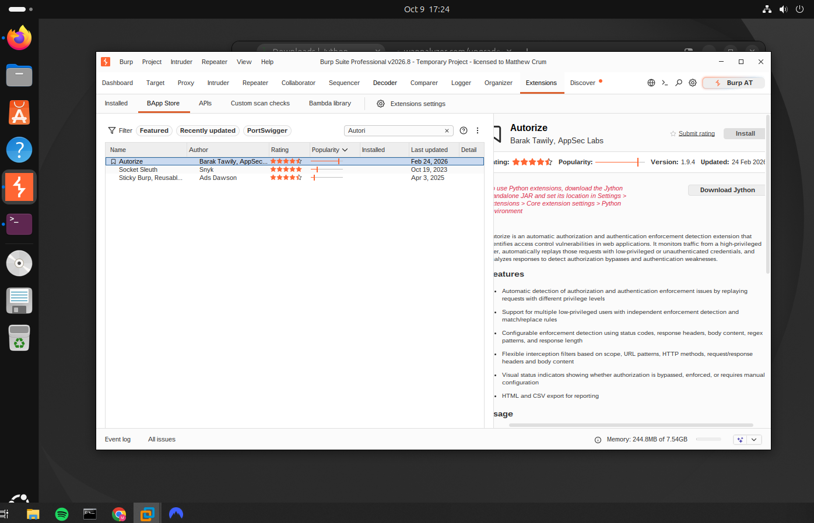

So first, Jython. I grabbed the standalone JAR from jython.org (the "Jython Standalone JAR" download, about 48 MB).

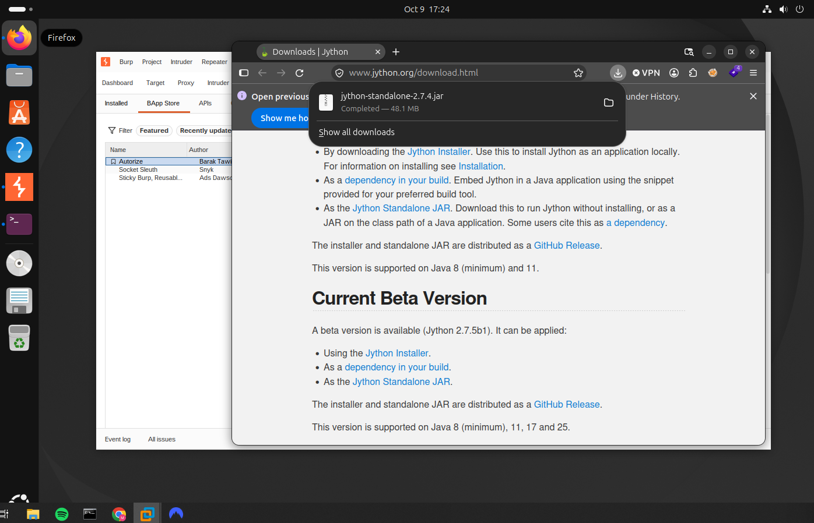

Then I pointed Burp at it: Settings → Extensions → Core extension settings → Python environment, and set "Location of Jython standalone JAR file" to the file I just downloaded.

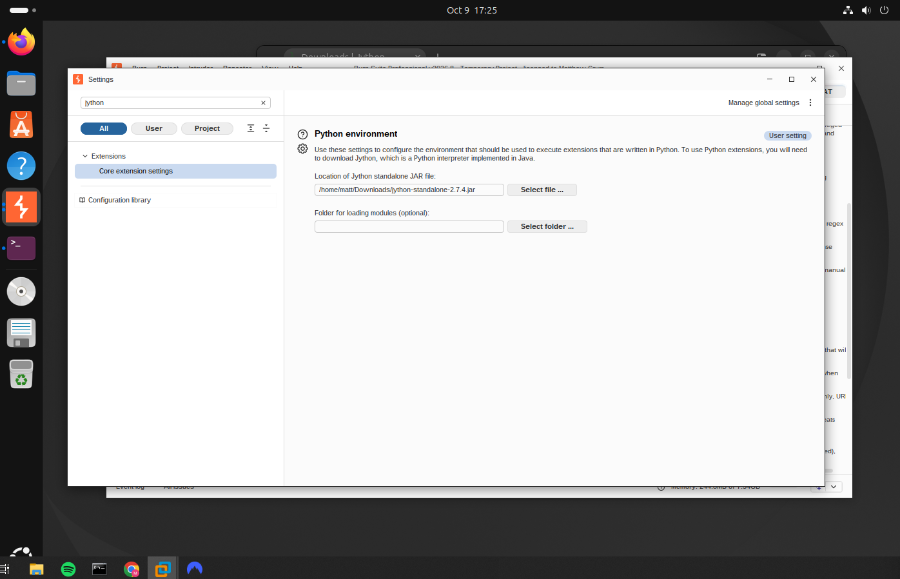

With Jython set, Autorize installed fine.

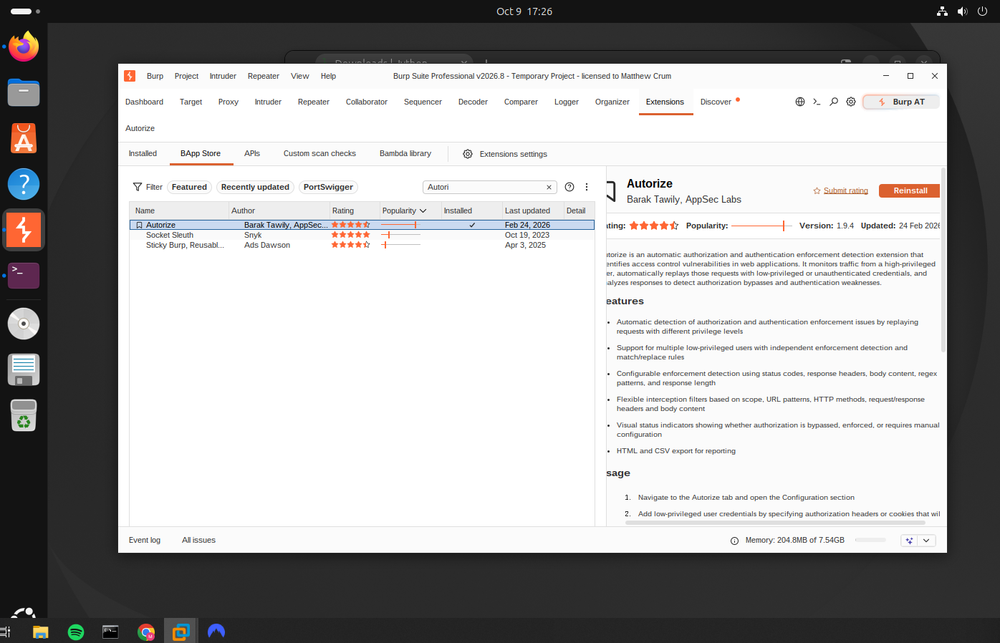

After that it's just the BApp Store: search the extension, hit Install, repeat. Here's the kit I installed and what each one is for:

- **Autorize** (Python): access-control testing. I browse as a high-privilege user and it replays every request as a low-privilege (or logged-out) user, flagging anything that still works. This is my main tool for IDOR and access-control bugs.
- **Turbo Intruder**: sends huge numbers of requests very fast, including single-packet attacks for race conditions.
- **Param Miner**: brute-forces hidden parameters and headers the app accepts but doesn't advertise.
- **JWT Editor**: decode, edit, and re-sign JSON Web Tokens, for testing auth and session bugs.
- **Logger++**: a detailed, searchable log of every request across all of Burp's tools.
- **Hackvertor**: inline encoding and transforms, so I can wrap a payload in base64, URL-encoding, and so on right inside a request.
- **Content Type Converter**: flips a request between JSON and form-encoded, handy for CSRF and content-type tricks.
- **JS Miner**: digs through JavaScript files for secrets, API keys, and endpoints.

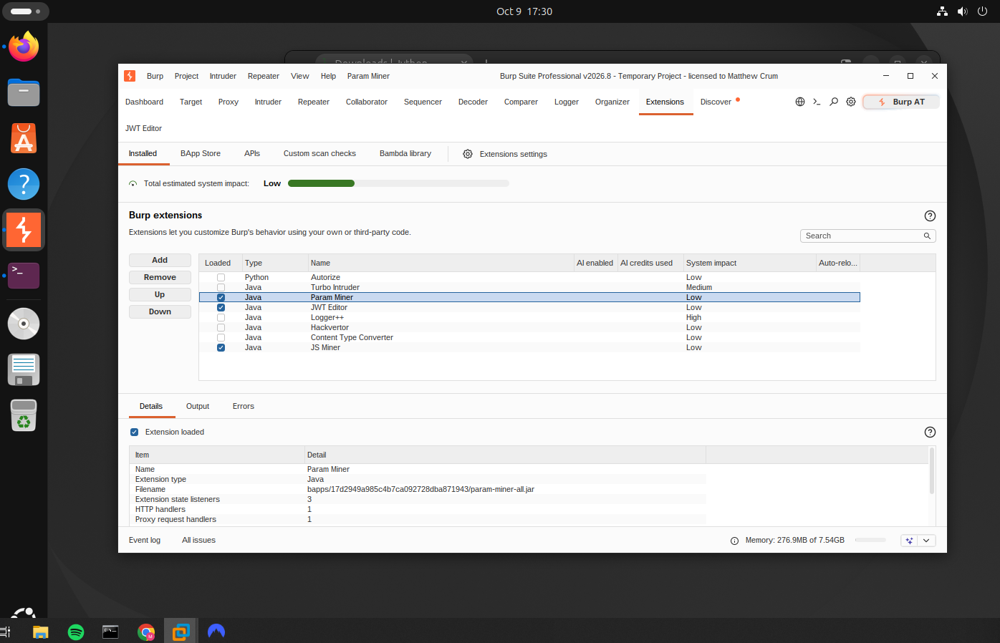
## Where things stand

The attacker side of the lab is fully stood up:

- VMware Workstation Pro installed
- Ubuntu attacker VM built: 4 vCPU, 16 GB RAM, 60 GB disk
- NAT + Host-Only networking verified end to end
- Clean baseline snapshot saved
- Base tooling, Go, and the initial recon/exploitation kit installed
- Burp Suite Professional running, with FoxyProxy and Wappalyzer in Firefox
- Burp set up with Jython and my extension kit (Autorize, Turbo Intruder, Param Miner, JWT Editor, Logger++, Hackvertor, Content Type Converter, JS Miner)

Next, I start building the first vulnerable target on the host.
